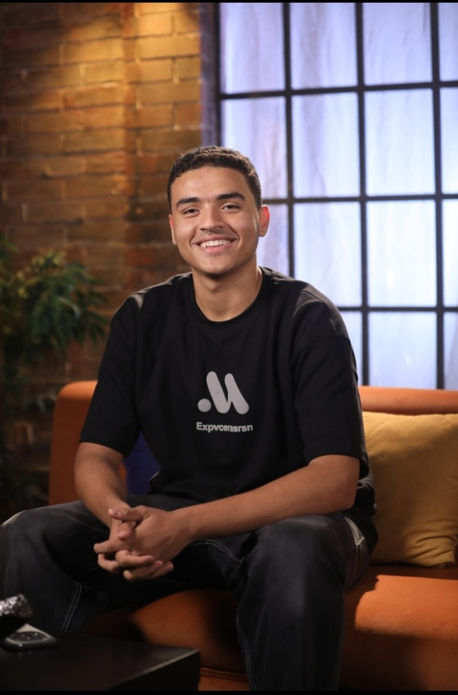

# Mostafa Mohamed Farhat (Elshorbagy)
### مصطفى محمد الشوربجي · Business Technology | Digital Projects | Creative & Technology

<table>
  <tr>
    <td width="235" align="center" valign="middle">
      
    </td>
    <td valign="middle">
      <p>
        <strong>Project Manager &amp; Acting Chief Technology Officer (CTO) at ProMedia</strong><br/>
        <strong>Founder &amp; Chief Executive Officer (CEO) at ProTech</strong><br/>
        <strong>Business Technology Student at Canadian International College (CIC), Cairo</strong>
      </p>
      <p>
        I am a multidisciplinary digital, creative, and business-technology professional operating across six interconnected domains: <strong>Media &amp; Entertainment</strong>, <strong>Marketing &amp; Business</strong>, <strong>Creative Direction &amp; Design</strong>, <strong>Video &amp; Photo Production</strong>, <strong>Content Creation</strong>, and <strong>Full-Stack Technology &amp; AI</strong>.
      </p>
      <p>
        My professional philosophy is to <em>understand an idea from its commercial root, develop its strategy and identity, execute the creative and production work, and build the digital platform that supports it</em>.
      </p>
      <p>
        🌐 <strong>Portfolio Website:</strong> <a href="https://mostafa-portfolio-iota.vercel.app/">mostafa-portfolio-iota.vercel.app</a><br/>
        📄 <strong>Official CV (PDF):</strong> <a href="./Mostafa_Elshorbagy_CV.pdf">View / Download CV</a> · <a href="https://mostafa-portfolio-iota.vercel.app/Mostafa_Elshorbagy_CV.pdf">Direct Live PDF</a><br/>
        📫 <strong>Connect:</strong>
        <a href="https://linkedin.com/in/mostafa-elshorbagy-077b52390">LinkedIn</a> ·
        <a href="https://www.instagram.com/__m5__sta__fa__/">Instagram</a> ·
        <a href="https://www.facebook.com/profile.php?id=100093230936090&locale=ar_AR">Facebook</a> ·
        <a href="mailto:mostafaelshorbagyofficial@gmail.com">mostafaelshorbagyofficial@gmail.com</a>
      </p>
    </td>
  </tr>
</table>

---

## 01. Professional Experience & Leadership

| Organization / Venture | Role & Title | Period | Scope & Key Contributions |
| :--- | :--- | :--- | :--- |
| **ProMedia** | **Project Manager \| Acting Chief Technology Officer (CTO)** | `July 2026 – Present` | Coordinate project delivery, timelines, and multidisciplinary workflows across digital, creative, and media initiatives; lead technical direction for interactive web platforms, B2B strategy simulators, brand decks, and creator media kits. |
| **ProTech** | **Founder & Chief Executive Officer (CEO)** | `Est. 26 Sept 2026 – Present` | Founded a technology-focused venture delivering digital solutions, full-stack web platforms, AI-assisted development, workflow automation, and technology partnerships. |
| **Save Money Project** | **Founder — 1st Place Winner (Step Forward Business Conference 2025)** | `2024 – 2025` | Founded a sustainability-driven venture focused on reducing food waste and optimizing household/commercial consumption; awarded **First Place** at CIC. |
| **Life Makers Foundation — Qalyubia** | **Volunteer Coordinator – Qalyubia Governorate \| Center Coordinator** | `2023 – 2025` | Coordinated governorate-level volunteers and community initiatives while building full-stack digital platforms (*Saboura El-Mahrousa* & *Life Makers Qalyubia*) to modernize operations. |

---

## 02. Education, Enterprise Training & Certifications

- **Canadian International College (CIC), Cairo, Egypt** — *Bachelor of Technology in Business Technology* (`2024 – Present`)
  - Academic focus spanning information systems, programming, relational databases (`SQL`), enterprise networking, and business management.
- **Egyptian Airports Company (`الشركة المصرية للمطارات`)** — *ICT Summer Trainee* (`July 2026`)
  - Practical enterprise exposure to computer networking, IT technical support, troubleshooting, airport network cybersecurity/ethical hacking concepts, and data center infrastructure.
- **ENGAZ AI Corporate (in partnership with CIC & CIC Entrepreneurs)** — *Artificial Intelligence Training Program* (`One-Month Program`)
  - Hands-on training in artificial intelligence applications, prompt engineering, and AI-assisted workflows for productivity and business execution.
- **TamooH Academy × Life Makers Foundation** — *Soft Skills for Career Advancement and Leadership Growth* (`Certified, 12 Training Hours`).
- **First Place Winner — Step Forward Business Conference 2025** at Canadian International College (*Save Money Project*).

---

## 03. The Six Interconnected Disciplines

```text
┌──────────────────────────────┐     ┌──────────────────────────────┐     ┌──────────────────────────────┐
│  01. MEDIA & ENTERTAINMENT   │────▶│   02. MARKETING & BUSINESS   │────▶│ 03. CREATIVE & GRAPHIC DESIGN│
│  Show platforms, media kits, │     │   B2B/B2C growth proposals,  │     │ Brand identity, UI/UX, art   │
│  broadcast & digital decks   │     │   lead simulators & strategy │     │ direction & pitch decks      │
└──────────────┬───────────────┘     └──────────────┬───────────────┘     └──────────────┬───────────────┘
               │                                    │                                    │
               ▼                                    ▼                                    ▼
┌──────────────────────────────┐     ┌──────────────────────────────┐     ┌──────────────────────────────┐
│04. VIDEO & PHOTO PRODUCTION  │◀────│     05. CONTENT CREATION     │◀────│ 06. TECHNOLOGY & DIGITAL DEV │
│Commercial photography, video │     │ Bilingual AR/EN scriptwriting│     │ Full-stack React/Next.js,    │
│production & studio workflows │     │ content calendars & copy     │     │ Supabase, SQL, AI & n8n      │
└──────────────────────────────┘     └──────────────────────────────┘     └──────────────────────────────┘
```

---

## 04. Technical Skills & Multidisciplinary Toolset

### Programming & Core Development
<p>
  &nbsp;&nbsp;
  &nbsp;&nbsp;
  &nbsp;&nbsp;
  &nbsp;&nbsp;
  &nbsp;&nbsp;
  &nbsp;&nbsp;
  &nbsp;&nbsp;
  
</p>

### Frontend, Backend, Databases & Dev Tooling
<p>
  &nbsp;&nbsp;
  &nbsp;&nbsp;
  &nbsp;&nbsp;
  &nbsp;&nbsp;
  &nbsp;&nbsp;
  &nbsp;&nbsp;
  &nbsp;&nbsp;
  &nbsp;&nbsp;
  &nbsp;&nbsp;
  &nbsp;&nbsp;
  &nbsp;&nbsp;
  &nbsp;&nbsp;
  &nbsp;&nbsp;
  &nbsp;&nbsp;
  
</p>

### UI/UX, Creative Suite, Data & Computer Vision
<p>
  &nbsp;&nbsp;
  &nbsp;&nbsp;
  &nbsp;&nbsp;
  &nbsp;&nbsp;
  &nbsp;&nbsp;
  &nbsp;&nbsp;
  &nbsp;&nbsp;
  &nbsp;&nbsp;
  
</p>

| Category | Verified Capabilities & Tools |
| :--- | :--- |
| **Programming & Development** | `HTML5`, `CSS3`, `JavaScript (ES6+)`, `TypeScript`, `Python`, `C++`, `Java`, `SQL` |
| **Frontend Development** | `React.js (v18/v19)`, `Next.js (v14–v16 App Router)`, `Tailwind CSS (v3/v4)`, `Framer Motion`, `Vite`, `Responsive RTL/LTR Bilingual UI`, `HTML5 Canvas 2D/3D` |
| **Backend Development** | `Node.js`, `Express.js`, `RESTful APIs`, `Webhooks`, `Serverless Edge Functions` |
| **Databases** | `Supabase (PostgreSQL, Auth, Real-Time)`, `PostgreSQL`, `MySQL`, `MongoDB`, `Relational Schema Design` |
| **AI & Automation** | `AI-Assisted Development`, `OpenAI / ChatGPT Workflows`, `Google Gemini`, `Prompt Engineering`, `n8n Workflow Automation`, `OpenCV / NumPy / Pandas` |
| **UI/UX & Creative Tools** | `Figma`, `Wireframing & Interactive Prototyping`, `Adobe Photoshop`, `Adobe Illustrator`, `Canva`, `Brand Identity Systems`, `Interactive Pitch Deck Design` |
| **Media Production** | `Adobe Premiere Pro`, `Adobe After Effects`, `Commercial Photography`, `Videography`, `Video Editing`, `Content Creation`, `Bilingual Scriptwriting` |
| **Business & Project Management** | `Project Management`, `Digital & Marketing Strategy`, `Account & Client Coordination`, `Business Development`, `Team Leadership`, `Public Pitching` |
| **IT & Networking** | `Enterprise Networking Fundamentals`, `IT Technical Support`, `Troubleshooting`, `Cybersecurity Fundamentals`, `Data Center Operations Exposure` |

---

## 05. Organized Repository & Project Showcase

### A. Flagship Portfolio & Civic Full-Stack Platforms
| Repository | Classification | Tech Stack | Live Deployment |
| :--- | :--- | :--- | :--- |
| [**mostafa-portfolio**](https://github.com/mostafaelshorbagyofficial/mostafa-portfolio) | **Personal Flagship Portfolio** (Founded & Engineered) | `React 19`, `TypeScript`, `Tailwind v4`, `Framer Motion`, `3D Canvas` | [mostafa-portfolio-iota.vercel.app](https://mostafa-portfolio-iota.vercel.app/) |
| [**saboura-elmahrousa-platform**](https://github.com/mostafaelshorbagyofficial/saboura-elmahrousa-platform) | **NGO Full-Stack Platform** (Volunteer Coordinator & Tech Lead — Life Makers Qalyubia) | `Next.js 16`, `TypeScript`, `Supabase`, `Recharts`, `Google Sheets API` | [saboura-elmahrousa-platform.vercel.app](https://saboura-elmahrousa-platform.vercel.app) |

### B. Media, Talk Show & Broadcast Partnership Platforms (ProMedia Ecosystem)
| Repository | Classification | Tech Stack | Live Deployment |
| :--- | :--- | :--- | :--- |
| [**-EL-TURKAYA-**](https://github.com/mostafaelshorbagyofficial/-EL-TURKAYA-) | **Official Talk Show Web Platform** (Developed at ProMedia) | `Next.js`, `TypeScript`, `Tailwind CSS`, `Framer Motion` | [el-turkaya.vercel.app](https://el-turkaya.vercel.app/) |
| [**promedia-aljazeera-presentation**](https://github.com/mostafaelshorbagyofficial/promedia-aljazeera-presentation) | **Broadcast Partnership Deck** (Developed at ProMedia) | `HTML5`, `CSS3`, `JavaScript` | [promedia-aljazeera-presentation.vercel.app](https://promedia-aljazeera-presentation.vercel.app) |
| [**k3abdayr-saden-presentation**](https://github.com/mostafaelshorbagyofficial/k3abdayr-saden-presentation) | **Season 3 Sponsorship Pitch Deck** (*K3AB DAYR × Saden/SIDN*) | `HTML5`, `CSS3`, `JavaScript` | [k3abdayr-saden-presentation.vercel.app](https://k3abdayr-saden-presentation.vercel.app/) |
| [**k3abdayr-presentation**](https://github.com/mostafaelshorbagyofficial/k3abdayr-presentation) | **Travel Series Production Proposal** (*K3AB DAYR*) | `HTML5`, `CSS3`, `JavaScript` | [k3abdayr-presentation.vercel.app](https://k3abdayr-presentation.vercel.app) |
| [**pro-media-microsite**](https://github.com/mostafaelshorbagyofficial/pro-media-microsite) | **Agency Interactive 3D Microsite** (ProMedia) | `Next.js`, `TypeScript`, `Three.js / R3F`, `Tailwind CSS` | [pro-media-microsite.vercel.app](https://pro-media-microsite.vercel.app) |
| [**promedia-studio**](https://github.com/mostafaelshorbagyofficial/promedia-studio) | **Agency Studio Portfolio Hub** (ProMedia) | `React`, `TypeScript`, `Tailwind CSS`, `Vite` | [promedia-studio-2est-zeta.vercel.app](https://promedia-studio-2est-zeta.vercel.app) |

### C. B2B & Commercial Brand Strategy Platforms (ProMedia Ecosystem)
| Repository | Classification | Tech Stack | Live Deployment |
| :--- | :--- | :--- | :--- |
| [**dongfeng-egypt-2026**](https://github.com/mostafaelshorbagyofficial/dongfeng-egypt-2026) | **24-Chapter B2B Marketing Strategy & Lead Simulator** (Client Deliverable) | `React 19`, `TypeScript`, `Tailwind CSS`, `Framer Motion` | [dongfeng-egypt-2026.vercel.app](https://dongfeng-egypt-2026.vercel.app/) |
| [**fullcare-presentation-**](https://github.com/mostafaelshorbagyofficial/fullcare-presentation-) | **38-Section Pharmaceutical Brand & Identity Platform** (Client Deliverable) | `React`, `TypeScript`, `Tailwind CSS`, `Vite` | [fullcare-presentation.vercel.app](https://fullcare-presentation.vercel.app/) |
| [**sahara-silk-presentation**](https://github.com/mostafaelshorbagyofficial/sahara-silk-presentation) | **10-Chapter Luxury Haircare Launch Experience** (Client Deliverable) | `React`, `JavaScript`, `Tailwind CSS`, `Vite` | [sahara-silk-presentation.vercel.app](https://sahara-silk-presentation.vercel.app/) |
| [**wardah-promedia**](https://github.com/mostafaelshorbagyofficial/wardah-promedia) | **F&B Brand Revitalization & Influencer Directory** (Client Proposal) | `React`, `TypeScript`, `Tailwind CSS`, `Vite` | [wardah-promedia.vercel.app](https://wardah-promedia.vercel.app/) |
| [**nuweiba-promedia**](https://github.com/mostafaelshorbagyofficial/nuweiba-promedia) | **16-Section Eco-Tourism Growth & Creator Strategy** (Client Proposal) | `React`, `JavaScript`, `Tailwind CSS`, `Vite` | [nuweiba-promedia.vercel.app](https://nuweiba-promedia.vercel.app/) |
| [**viv-digital-presentation**](https://github.com/mostafaelshorbagyofficial/viv-digital-presentation) | **F&B Brand Growth & Digital Pitch Deck** (*VIV Croissants*) | `React`, `TypeScript`, `Tailwind CSS`, `Vite` | [viv-digital-presentation.vercel.app](https://viv-digital-presentation.vercel.app) |
| [**dream-store-presentation**](https://github.com/mostafaelshorbagyofficial/dream-store-presentation) | **Retail Brand, Content & E-Commerce Strategy** (*Dream Store Mobiles*) | `HTML5`, `CSS3`, `JavaScript`, `Vite` | [dream-store-presentation.vercel.app](https://dream-store-presentation.vercel.app) |

### D. Creator Economy Digital Media Kits & Executive Brand Platforms
| Repository | Classification | Tech Stack | Live Deployment |
| :--- | :--- | :--- | :--- |
| [**elzuzzat-digital-media-kit**](https://github.com/mostafaelshorbagyofficial/elzuzzat-digital-media-kit) | **Creator Duo Digital Media Kit & 32-Reel Showcase** (*ProMedia × ElZuzzat*) | `React`, `TypeScript`, `Tailwind CSS`, `Vite` | [elzuzzat-digital-media-kit.vercel.app](https://elzuzzat-digital-media-kit.vercel.app/) |
| [**promedia--MAZEN-ADLY-presentation**](https://github.com/mostafaelshorbagyofficial/promedia--MAZEN-ADLY-presentation) | **Solo Creator Media Kit & 28-Reel Showcase** (*ProMedia × Mazen Adly*) | `React`, `TypeScript`, `Tailwind CSS`, `Vite` | [promedia-mazen-adly-presentation.vercel.app](https://promedia-mazen-adly-presentation.vercel.app/) |
| [**promedia-moaz-adly**](https://github.com/mostafaelshorbagyofficial/promedia-moaz-adly) | **Solo Creator Media Kit & 19-Item Portfolio** (*ProMedia × Moaz Adly*) | `React`, `TypeScript`, `Tailwind CSS`, `Vite` | [promedia-moaz-adly.vercel.app](https://promedia-moaz-adly.vercel.app/) |
| [**bedaya-website**](https://github.com/mostafaelshorbagyofficial/bedaya-website) | **Corporate Industrial Web Platform** (*Bedaya Engineering Industries*) | `JavaScript`, `HTML5`, `CSS3` | [bedaya-website.vercel.app](https://bedaya-website.vercel.app) |
| [**dr-osama**](https://github.com/mostafaelshorbagyofficial/dr-osama) | **19-Chapter Healthcare Personal Brand Platform** (*Dr. Osama Taha*) | `React 19`, `TypeScript`, `Tailwind CSS v4`, `Framer Motion` | [dr-osama-lyart.vercel.app](https://dr-osama-lyart.vercel.app) |
| [**nabil-elbasyouni-portfolio**](https://github.com/mostafaelshorbagyofficial/nabil-elbasyouni-portfolio) | **Bilingual Executive Portfolio** (*Eng. Nabil El-Basyouni*) | `React`, `JavaScript`, `Vite` | [nabil-elbasyouni-portfolio.vercel.app](https://nabil-elbasyouni-portfolio.vercel.app) |
